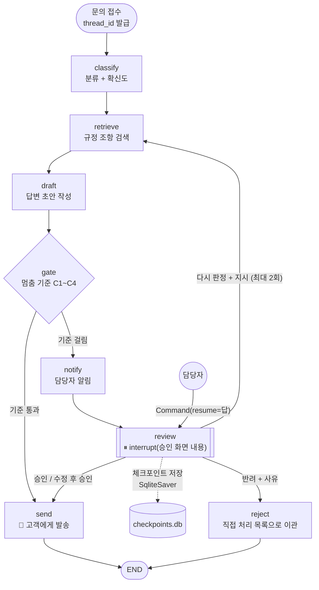
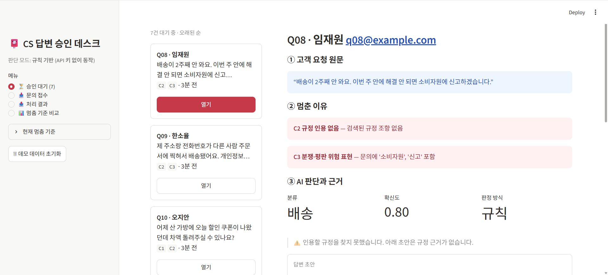
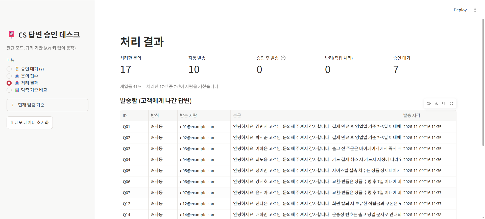
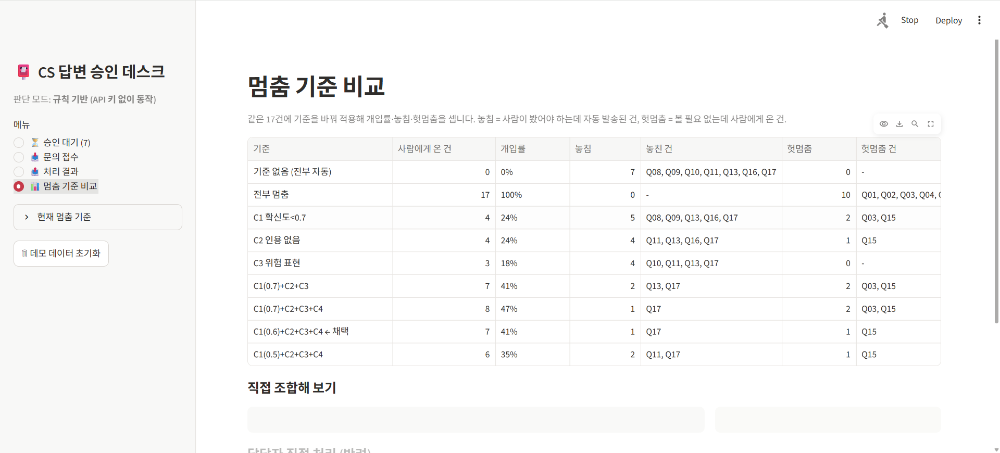

# REPORT: 사람이 승인하는 고객 문의 자동 답변 에이전트

## 1. 주제와 고른 이유

**자동화한 업무:** 쇼핑몰 고객센터의 1차 문의 답변.
문의를 읽고 → 카테고리를 정하고 → 해당 규정 조항을 찾아 → 답변 메일을 써서 → 고객에게 보냅니다.

**결과가 바깥으로 나가는 단계:** 마지막 `send`(고객에게 메일 발송 + 문의 종결)입니다.
앞의 분류·검색·작성은 틀려도 다시 하면 되지만, 메일은 한 번 나가면 회수할 수 없고
고객은 그 내용을 회사의 공식 약속으로 받아들입니다. 그래서 HITL을 `send` 바로 앞에 두었습니다.

**고른 이유**

- 문의 대부분(배송 기간, 반품 방법, 탈퇴 시 적립금 등)은 규정 그대로 답하면 되는 반복 업무라 자동화 효과가 큽니다.
- 반대로 소수의 건(신고 예고, 개인정보 사고, 규정에 없는 보상 요구, 해석이 갈리는 하자)은 정형 답변 한 통이 분쟁으로 번집니다.
  **"대부분은 자동, 소수만 사람"** 이라는 HITL의 전제가 잘 맞는 업무입니다.

## 2. 파이프라인 구조도

**State 흐름**

| 단계 | 상태에 추가되는 값 |
|---|---|
| 시작 | `inquiry` (고객, 이메일, 원문), `redo_count=0` |
| classify | `category`, `confidence`, `classified_by` (rule / llm / human) |
| retrieve | `citations` (조항 id + 원문) |
| draft | `draft` |
| gate | `reasons` (걸린 기준 목록. 비어 있으면 자동 발송) |
| notify | `stopped_at` |
| review (재개 후) | `decision`, `history`(누적), 재판정이면 `redo_count`, `instruction`, (선택) `category` |
| send / reject | `final`, `status` (sent / rejected) |

**구조를 짤 때 지킨 원칙**

- **만드는 일과 보내는 일 분리:** `draft`는 초안만 만들고, 바깥으로 나가는 동작은 `send` 하나에만 있습니다.
- **묻는 단계 안에 바깥 동작을 두지 않음:** 재개하면 `review`가 첫 줄부터 다시 실행되므로,
  담당자 알림은 별도 노드 `notify`로 뺐습니다. 실행 결과 승인 대기 7건에 알림이 정확히 8회
  (7건 + 다시 판정 후 재요청 1회) 나갔고, 재개할 때 중복 발송은 없었습니다.
- **발송은 멱등:** `store.send_email`은 `thread_id`를 기본키로 써서 같은 건이 두 번 불려도 한 번만 나갑니다.
- **대기 건은 파일에 보관:** `SqliteSaver`를 써서 앱을 재시작해도 승인 대기 목록이 그대로 남습니다.
  승인 대기 목록은 "`get_state().next`가 비어 있지 않고 interrupt가 걸린 thread"로 만듭니다.

## 3. 승인 기준과 그 이유

모든 기준은 `criteria.py`에 계산 가능한 조건으로 들어 있습니다. 하나라도 걸리면 멈춥니다.

| 코드 | 기준 (계산식) | 대비하려는 위험 |
|---|---|---|
| **C1** | 분류 확신도 `< 0.6` | 문의를 잘못 분류하면 엉뚱한 규정으로 답합니다. 요청이 두 개 섞인 문의(입금 확인 + 배송지 변경)가 대표적이며, 한쪽만 답하면 나머지가 누락됩니다. |
| **C2** | 검색된 조항이 0개 **또는** 답변 본문에 `[OO규정 N조]` 인용이 없음 | 근거 없는 답변은 규정에 없는 약속(쿠폰 차액 환불 등)이 되기 쉽습니다. LLM 모드에서 모델이 근거 없이 지어낸 답변도 이 기준에 걸립니다. |
| **C3** | 문의 원문에 위험 표현 포함: 소비자원·신고·고소·소송·법적·변호사·유출·언론·보상·배상·리뷰에·피해 | 신고 예고, 개인정보 사고, 악성 리뷰 예고에 정형 답변을 보내면 분쟁이 커집니다. 어조와 후속 조치는 사람이 정해야 합니다. |
| **C4** | 결론이 반대인 조항 쌍이 함께 검색됨 (`교환반품 3조 하자→무상` ↔ `4조 세탁 흔적→제한`) | "세탁했더니 줄었다"처럼 하자인지 사용 흔적인지 해석이 갈리는 건을 AI가 한쪽으로 정해 버리는 것을 막습니다. |
| (R) | 담당자가 '다시 판정'을 시킨 건 | 지시를 반영한 재작성 결과는 다시 사람이 확인합니다. |

**자동으로 처리되는 건은 왜 사람이 보지 않아도 괜찮은가**

자동 발송 조건은 **"한 카테고리로 분명히 분류되고, 근거 조항을 찾아 인용했고, 위험 표현이 없고, 조항끼리 충돌하지 않는다"** 입니다.
이 조건을 모두 만족하면 답변 내용이 규정 원문을 옮긴 것이라, 틀려도 규정에 이미 적힌 범위를 벗어나지 않습니다.

| 자동 처리 예 | 왜 괜찮은가 |
|---|---|
| Q02 "제주도인데 배송 며칠 걸려요?" → 배송규정 1·2조 | 규정 문장 그대로의 정보 안내 |
| Q07 "색이 마음에 안 들어서 반품하고 싶어요" → 교환반품 1·2조 | 단순 변심 배송비 규정이 명확, 해석 여지 없음 |
| Q12 "탈퇴하면 적립금은?" → 회원규정 1조 | 사실 안내, 금전 약속 없음 |

**C1 임계값을 0.6으로 정한 근거: 같은 17건으로 비교** (`python eval_criteria.py`)

| 기준 | 사람에게 온 건 | 개입률 | 놓침 | 놓친 건 | 헛멈춤 | 헛멈춤 건 |
|---|---|---|---|---|---|---|
| 기준 없음 (전부 자동) | 0 | 0% | 7 | Q08, Q09, Q10, Q11, Q13, Q16, Q17 | 0 | - |
| 전부 멈춤 | 17 | 100% | 0 | - | 10 | Q01~Q07, Q12, Q14, Q15 |
| C1 확신도<0.7 | 4 | 24% | 5 | Q08, Q09, Q13, Q16, Q17 | 2 | Q03, Q15 |
| C2 인용 없음 | 4 | 24% | 4 | Q11, Q13, Q16, Q17 | 1 | Q15 |
| C3 위험 표현 | 3 | 18% | 4 | Q10, Q11, Q13, Q17 | 0 | - |
| C1(0.7)+C2+C3 | 7 | 41% | 2 | Q13, Q17 | 2 | Q03, Q15 |
| C1(0.7)+C2+C3+C4 | 8 | 47% | 1 | Q17 | 2 | Q03, Q15 |
| **C1(0.6)+C2+C3+C4 ← 채택** | **7** | **41%** | **1** | Q17 | **1** | Q15 |
| C1(0.5)+C2+C3+C4 | 6 | 35% | 2 | Q11, Q17 | 1 | Q15 |

- 기준 하나만으로는 놓침이 4~5건입니다. **걸리는 이유가 서로 다른 건**(분류 애매 / 근거 없음 / 분쟁 위험 / 해석 충돌)을 잡으려면 종류가 다른 기준을 합쳐야 합니다.
- C4를 더하자 해석이 갈리는 Q13이 잡혀 놓침이 2 → 1로 줄었습니다.
- 임계값 0.7 → 0.6: 헛멈춤 Q03(출고 전 취소, 확신도 0.67)이 빠지고 놓침은 그대로입니다. 0.5로 더 내리면 요청이 섞인 Q11을 놓칩니다. 그래서 0.6을 골랐습니다.
- **놓침과 헛멈춤 중 놓침이 더 비쌉니다.** 헛멈춤은 담당자 10초, 놓침은 잘못된 메일 한 통(회수 불가)입니다. 남은 헛멈춤 1건(Q15)은 감수하기로 했습니다.

## 4. 실행 결과

`python demo_run.py`. 규칙 기반 모드, 샘플 17건 (`results/run_log.md`).

- **1차 처리:** 17건 중 **10건 자동 발송**, **7건 승인 대기** (개입률 41%)
- **멈춘 7건을 담당자가 처리한 방식**

| ID | 멈춘 이유 | 담당자 답 | 처리 내용 | 최종 |
|---|---|---|---|---|
| Q08 | C2, C3 (소비자원·신고) | ✏️ 수정 후 승인 | 사과 + 택배사 사고 접수 + 오늘 중 재발송으로 고쳐 발송 | 발송 |
| Q09 | C2, C3 (유출) | ⛔ 반려 | 개인정보 사고 의심 → 보안 담당자에게 이관 | 직접 처리 |
| Q10 | C1, C2 (쿠폰 차액) | 🔁 다시 판정 → ✅ 승인 | "차액 보상 규정 없음을 정중히 안내" 지시 → 재작성본 다시 대기 → 승인 | 발송 |
| Q11 | C1 (요청 2개 섞임) | ✏️ 수정 후 승인 | 입금 확인 + 배송지 변경 두 가지 모두 답하도록 수정 | 발송 |
| Q13 | C4 (하자 vs 세탁) | ⛔ 반려 | 실물 검수 필요 → 회수 후 판정으로 이관 | 직접 처리 |
| Q15 | C1, C2 (헛멈춤) | ✅ 승인 | 초안이 맞음. 확인만 하고 통과 | 발송 |
| Q16 | C3 (보상·리뷰에) | ✏️ 수정 후 승인 | 사과 문장 추가, 보상 약속은 넣지 않음 | 발송 |

- **최종 집계:** 발송 15건 (자동 10, 수정 승인 3, 그대로 승인 2) · 반려 2건 · 남은 대기 0건 · 담당자 알림 8회
- **놓친 1건(Q17):** "결혼식이 모레라 내일까지 받아야 해요". 배송 문의로 확신도 0.80, 규정 인용도 있어 자동 발송됐지만,
  고객의 진짜 요구(기한)에는 답하지 못했습니다. 지금 기준에는 **"고객이 기한을 걸었는가"를 보는 신호가 없습니다.** (6장 보완점)
- 응답 중 **수정 후 승인이 3건으로 가장 많았습니다.** 승인/반려 두 버튼만 있었다면 이 3건은 반려 후 수작업이 됐을 것입니다.

## 5. 데모 화면 설계

**승인 대기 상세 화면** (Q08: 소비자원 신고 예고로 멈춘 건)

**목표: 담당자가 다른 시스템을 열지 않고 10초 안에 판단한다.**

**승인 화면에 보여 주는 것 (위에서 아래 순서)**

1. **고객 요청 원문:** 요약하지 않은 원문. 어조(화남, 신고 예고)는 요약하면 사라집니다.
2. **멈춘 이유:** 걸린 기준 코드와 구체적 값(`확신도 0.30 < 0.60`, `'소비자원','신고' 포함`). 무엇을 의심하며 봐야 하는지 알려 줍니다. 원문보다 먼저 눈에 띄도록 빨간 박스로 표시합니다.
3. **AI 판단과 근거:** 분류, 확신도, 판정 방식(규칙/Claude/담당자 지정), **인용한 규정 원문**. 규정 문서를 따로 찾을 필요가 없습니다. 근거가 없으면 "근거 없음" 경고를 띄웁니다.
4. **답변 초안:** 실제로 나갈 본문 그대로.
5. **승인하면:** "OOO 고객(이메일)에게 위 답변이 메일로 발송되고 문의가 종결됩니다. 발송 후에는 회수할 수 없습니다." 승인 버튼의 무게를 알려 줍니다.

**응답 네 가지**

| 응답 | 동작 | 설계 이유 |
|---|---|---|
| ✅ 승인 | 초안 그대로 발송 | |
| ✏️ 수정 후 승인 | 초안이 채워진 편집창에서 고친 본문을 발송 (`mode=human-edited`로 기록) | 실무에서 가장 많이 쓰입니다 (데모에서도 3/7) |
| ⛔ 반려 | **사유 필수**, 발송하지 않고 '직접 처리' 목록으로 이관 | 사유가 쌓여야 기준을 고칠 수 있습니다 |
| 🔁 다시 판정 | 지시문 + (선택) 분류 바로잡기 → 규정 검색부터 다시 → **결과를 다시 사람이 확인** | 최대 2회로 제한해 무한 반복을 막습니다 |

**그 밖의 화면**

- 대기 목록: 고객명, 원문 앞부분, 걸린 기준 코드, 대기 시간. **3일 넘게 대기하면 ⚠️ 표시와 "팀장 에스컬레이션 대상" 경고** (운영 규칙)
- 처리 결과: 자동/승인/수정 승인 건수, 개입률, 발송함, 반려 목록, 담당자 알림 기록
- 기준 비교: 위 비교표 + 기준 조합과 임계값을 직접 바꿔 놓침·헛멈춤을 바로 확인

**처리 결과 화면** (17건 처리 직후: 자동 발송 10, 승인 대기 7)

**멈춤 기준 비교 화면**

**뺀 것과 이유**

- **분류 확신도의 세부 계산식, 키워드 점수:** 담당자 판단에 도움이 되지 않고 화면만 길어집니다. 숫자 하나(확신도)와 멈춘 이유만 남겼습니다.
- **주문 상세(상품, 결제 내역):** 이번 데모에는 주문 시스템 연동이 없습니다. 실제 서비스라면 C3/C4 건에서는 필요하므로 보완 대상입니다.
- **일괄 승인 버튼:** 헛멈춤이 많아지면 편하겠지만, 내용을 보지 않고 누르는 습관을 만듭니다. 대신 기준을 고쳐 헛멈춤을 줄이는 쪽을 택했습니다.

## 6. 프로젝트 회고

**가장 공들인 부분**

- **멈춤 기준을 "종류가 다른 신호"로 나눈 것.** 처음에는 확신도 하나로 해결하려 했지만, 비교표에서 C1 단독은 놓침이 5건이었습니다.
  놓친 건을 하나씩 보니 이유가 모두 달랐고(신고 예고, 개인정보, 해석 충돌), 각 이유를 계산 가능한 신호(C2~C4)로 바꾸니 놓침이 1건까지 줄었습니다.
- **재개 시 재실행 문제를 구조로 막은 것.** 알림을 `review` 밖 `notify` 노드로 빼고, 발송은 `thread_id` 기준 멱등으로 만들어
  재개나 재시작이 몇 번 일어나도 고객과 담당자가 같은 메시지를 두 번 받지 않게 했습니다.

**앞으로 보완하고 싶은 점**

1. **기한 신호(C5) 추가:** Q17처럼 "내일까지", "모레", "급해요" 같은 기한 표현이 있으면 멈추게 합니다. 지금 기준의 유일한 놓침입니다.
2. **LLM 모드에서 확신도 검증:** 규칙 기반 확신도는 키워드 분포라서 해석이 쉽지만, LLM이 스스로 말한 확신도는 실제 정답률과 어긋날 수 있습니다.
   LLM 모드로 같은 비교표를 다시 만들어 임계값을 따로 맞춰야 합니다.
3. **답변 쪽 위험 검사:** 지금 C3는 문의 원문만 봅니다. 초안에 "보상해 드리겠습니다", "무료로" 같은 규정 밖 약속이 들어갔는지도 검사해야 합니다.
4. **데이터 규모:** 17건은 기준을 비교하는 방법을 보여 주기에는 충분하지만 임계값을 확정하기에는 적습니다. 실제 문의 수백 건에 정답 라벨을 붙여 다시 비교해야 합니다.
5. **운영 기능:** 3일 초과 대기 건 자동 에스컬레이션(지금은 표시만 함), 담당자 로그인과 승인자 기록, 반려 사유를 모아 기준을 고치는 주간 리포트.
